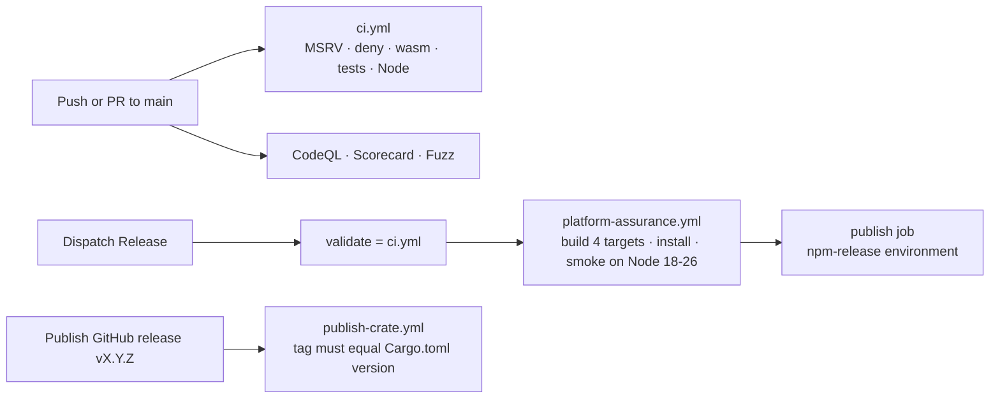

# Contributing to narrative-lens

Thanks for considering a contribution. This crate is a standalone, dependency-light
extraction of Emathy's manuscript-analysis engine. Analyzers are pure functions: text
in, a structured result out, with no project model, storage, or revision history.
Those belong in the consuming application.

## Reporting bugs and suggesting enhancements

Use the [issue tracker](https://github.com/writerslogic/narrative-lens/issues).

- **Bug:** the passage you analyzed, the result you got, the result you expected, and the crate or package version.
- **Enhancement:** the category (craft, structure, continuity) and a realistic test passage.
- **Security issue:** follow [SECURITY.md](./SECURITY.md) instead of opening a public issue.

## Development setup

```bash
git clone https://github.com/writerslogic/narrative-lens.git
cd narrative-lens
cargo test                                   # Rust analyzers and facade
npm ci && npm run build:debug && npm test    # native addon and Node tests
```

| Check | Command |
| --- | --- |
| Rust tests, all feature sets | `cargo test --locked --workspace` plus `--features onnx`, `--features bindings`, `--all-features` |
| Lint | `cargo clippy --locked --all-targets --all-features -- -D warnings` |
| Generated contracts are current | `cargo run --locked --features bindings --example export_contracts -- --check` and `... --example export_standalone_contracts -- --check` |
| Strict TypeScript against the bindings | `npm run test:types` |
| Node examples | `npm run test:examples` |
| Node output matches the JSON schemas | `npm run test:contracts` |
| Packed tarballs install without a registry | `npm run test:package` |
| Pinned fixtures and readability data | `uv run --no-project scripts/verify_fixtures.py` and `uv run --no-project scripts/verify_readability_resources.py` |
| Fuzzing (nightly) | `cargo +nightly fuzz run text_analysis -- -max_total_time=120 -max_len=4096 -timeout=10` |

## Before opening a PR

- Tests and clippy pass for the feature sets you touched.
- A new analyzer ships with a test against at least one realistic passage whose expected
  result was authored by reading the input text, not the analyzer code.
- Public wire changes regenerate the manuscript and standalone contracts (commands above).
  Generated declarations and schemas are never hand-edited.
- Model-profile changes run the native fixture tests and the WASI runner, comparing label
  permutations and tied logits as well as tensor shapes.
- Update `docs/ARCHITECTURE.md` when analyzer categories or availability change, and add
  a `CHANGELOG.md` entry for anything a consumer can notice.

## Adding an analyzer

Pick the category by what the analyzer answers, not the technique it uses: a craft
analyzer that uses an embedding model is still a craft analyzer. Keep it a pure
function with no filesystem access, network call, or shared mutable state beyond its
arguments. Reserved capabilities report `availability: unavailable` rather than guessing.

## CI and release flow



Cutting a release:

1. Bump `version` in `Cargo.toml`, `Cargo.lock`, `package.json`, and `package-lock.json`.
2. Move the `Unreleased` notes in `CHANGELOG.md` under the new version and date.
3. Commit, tag `vX.Y.Z`, and push the tag.
4. Publish a GitHub release for the tag: `publish-crate.yml` verifies the tag matches
   `Cargo.toml` and runs `cargo publish` (needs the `CARGO_REGISTRY_TOKEN` secret).
5. Dispatch the `Release` workflow on `main`: it runs CI, builds and smoke-tests every
   declared target through `platform-assurance.yml`, then publishes only tarballs whose
   digests and smoke attestations match (needs `NPM_TOKEN` in the `npm-release` environment).

`platform-assurance.yml` can also be dispatched on its own to rehearse a release without publishing.

## Code of Conduct

This project follows the [Contributor Covenant](./CODE_OF_CONDUCT.md).
