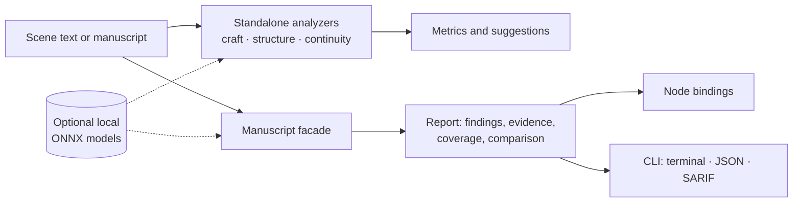

### narrative-lens

Local, deterministic prose and narrative-craft analysis (readability, pacing, voice, foreshadowing, continuity) with no LLM and no network call. Extracted from Emathy's meaning engine, for Rust and Node.

[](https://github.com/writerslogic/narrative-lens/actions/workflows/ci.yml) [](https://github.com/writerslogic/narrative-lens/actions/workflows/codeql.yml) [](https://securityscorecards.dev/viewer/?uri=github.com/writerslogic/narrative-lens) [](https://www.npmjs.com/package/narrative-lens) [](https://github.com/writerslogic/narrative-lens/blob/main/LICENSE)

<p align="center">
  <a href="#install">Install</a> &middot;
  <a href="#what-it-analyzes">What It Analyzes</a> &middot;
  <a href="#api">API</a> &middot;
  <a href="#guides">Guides</a> &middot;
  <a href="#contributing">Contributing</a>
</p>

---

narrative-lens analyzes passages and manuscripts with local heuristics and optional local models. Standalone analyzers return their own metrics and suggestions. The manuscript facade adds typed findings with original-text evidence, author controls, coverage, and revision comparison. Confidence is explicitly uncalibrated unless identified otherwise: these are review aids, not editorial validation.



Run [the Rust example](examples/manuscript.rs) or [the async Node example](examples/manuscript.mjs) to analyze a manuscript and compare revisions.

## Install

```bash
npm install narrative-lens
```

```toml
[dependencies]
narrative-lens = "0.2"
```

<details>
<summary><strong>Optional: local ONNX models for embeddings, NER, NLI, and emotion</strong></summary>

The default analyzers are pure Rust with no model to load. Enable the `onnx` feature for local SBERT embeddings, BERT NER, NLI, and Ekman-7 emotion classification. Verified loaders pin model and tokenizer bytes and validate declared preprocessing and label order; Node exposes `loadVerifiedModel`, and the CLI accepts `--model-root`/`--model-profile`. No model is downloaded. See [Integration](docs/INTEGRATION.md).

</details>

## What It Analyzes

| Category | Shipped | Reserved or partial |
|----------|---------|---------------------|
| **Prose craft** | Readability (FKGL, SMOG, Dale-Chall), pacing, prose quality, dialogue extraction and realism, voice consistency and drift, syntax tension, lexical variety, grammar, emotion (model-backed) | Subtext reports `unavailable` |
| **Narrative structure** | Foreshadowing, inferred promise/payoff ledger, author-confirmed setup/resolution events, theme presence, semantic novelty, opening-page analysis, structure templates, genre detection and convention checks | Unobserved payoffs stay `unknown`; thematic argument reports `unavailable` |
| **Continuity and world state** | Timeline consistency, explicit physical-state tracking, author truth/belief/knowledge annotations, coreference, entity and named-entity resolution, causal and epistemic heuristics, anachronism detection, gap signals | Unannotated knowledge stays unassessed; reader mental model reports `unavailable` |

Analyzers accept caller-supplied text and return structured results. Persistence and project storage belong to the caller.

## API

<details>
<summary><strong>Rust</strong> -- analyzers, types, feature flags</summary>

| Module | What it does |
|--------|-------------|
| `manuscript` | Coordinated findings, controls, coverage, chronology, incremental `AnalysisContext`, revision comparison |
| `craft::*` | Readability, pacing, prose quality, dialogue, voice, emotion, syntax tension, lexical, lexicon, grammar |
| `structure::*` | Foreshadowing, promise/payoff, author events, theme, narrative entropy, opening analysis, templates, genre |
| `continuity::*` | Timeline, world state, coreference, entity/NER, author knowledge, causal, epistemic, gap analysis, anachronism |
| `substrate::*` | Text segmentation, offsets, word statistics, embeddings, confidence scoring, explanations |

| Feature | Adds |
|---------|------|
| `onnx` | Local model runtimes: `ort` natively, `tract` on wasm32 |
| `cli` | The `narrative-lens` binary |
| `node-api` | napi bindings (built through npm, not needed by Rust consumers) |
| `bindings` | TypeScript declaration and JSON schema generation |

Each standalone analyzer keeps its own signature, such as `readability::compute_readability(text)`. `manuscript::analyze_manuscript(&Manuscript)` coordinates supported passes into a `Report`.

</details>

<details>
<summary><strong>Node.js</strong> -- the same analyzers, generated bindings</summary>

Most standalone analyzers are exposed through napi with TypeScript declarations in `index.d.ts`; the manuscript API is typed in `manuscript.d.ts`. Use `analyzeManuscriptAsync`, `ManuscriptContext.analyzeAsync`, and `compareManuscriptReports` for responsive manuscript workflows. See [Integration](docs/INTEGRATION.md) for coverage.

</details>

## Guides

- **[Architecture](./docs/ARCHITECTURE.md)** -- layers, analyzer categories, and what is reserved vs. shipped
- **[Integration](./docs/INTEGRATION.md)** -- Rust, Node, world-state APIs, and verified local models
- **[Manuscript API](./docs/MANUSCRIPT.md)** -- findings, author controls, coverage, chronology, caching, comparisons
- **[CLI](./docs/CLI.md)** -- text/Markdown adapter, JSON, SARIF, baselines, exit codes
- **[Evaluation](./docs/EVALUATION.md)** -- synthetic accuracy fixtures, LitBank development-split benchmark, performance
- **[Contributing](./CONTRIBUTING.md)** -- development setup, checks, and the release process

## Requirements

| Build | Minimum |
|-------|---------|
| Rust core, `cli`, `bindings` | Rust 1.89 |
| Native ONNX (`onnx`) | Rust 1.92 |
| wasm32 ONNX (`tract`) | Rust 1.91 |
| Node package | Node.js 18, 20, 22, 24, or 26 on macOS, Linux (glibc 2.28+), or Windows |

No API key, no network access, no external service of any kind.

## Development

```bash
git clone https://github.com/writerslogic/narrative-lens.git
cd narrative-lens
cargo test                                  # Rust analyzers and facade
npm ci && npm run build:debug && npm test   # native addon; tests fail if it is missing
npm run test:types                          # strict TS check against generated bindings
```

## Why narrative-lens

Readability formulas, mechanical checks, and explicit state tracking can run locally on the caller's text. narrative-lens gives editors, MCP servers, and manuscript CI tools deterministic results with inspectable evidence. Craft and continuity heuristics still need author judgment; supported patterns, evaluation limits, and measured performance are documented.

## Contributing

Contributions of all sizes are welcome. Check the [issue tracker](https://github.com/writerslogic/narrative-lens/issues) or see [CONTRIBUTING.md](./CONTRIBUTING.md).

Help is especially welcome on:
- Language support beyond English for the craft and structure analyzers
- Evaluation fixtures for the continuity analyzers against real manuscript excerpts
- Integration examples for MCP servers and manuscript tooling beyond Emathy and scrivener-mcp

## Security

Found a vulnerability? Report it privately: see [SECURITY.md](./SECURITY.md).

## License

Apache-2.0 &copy; [WritersLogic, Inc.](https://github.com/writerslogic)

<p align="center">
  <a href="https://github.com/writerslogic/narrative-lens">GitHub</a> &middot;
  <a href="https://www.npmjs.com/package/narrative-lens">npm</a> &middot;
  <a href="https://crates.io/crates/narrative-lens">crates.io</a> &middot;
  <a href="https://github.com/writerslogic/narrative-lens/issues">Issues</a> &middot;
  <a href="./CHANGELOG.md">Changelog</a>
</p>
