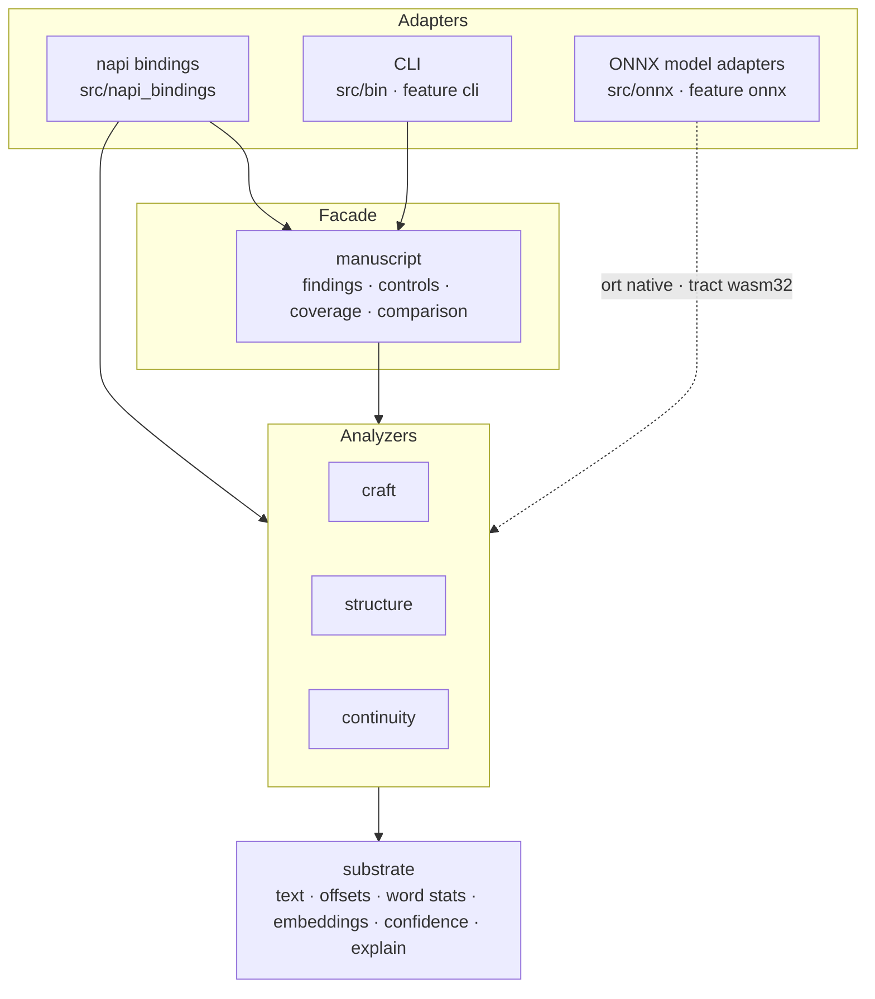

# Architecture

Every layer below the adapters is a pure function of its arguments: no filesystem,
network, or persistence. Filesystem handling lives in the CLI and model adapters;
project storage and revision history belong to the caller.

## Analyzer categories

| Category | Modules | Answers |
| --- | --- | --- |
| `craft` | `readability`, `pacing`, `prose_quality`, `dialogue`, `dialogue_realism`, `voice`, `emotion`, `syntax_tension`, `lexical`, `lexicon`, `grammar`, `subtext` | Sentence- and paragraph-level prose quality |
| `structure` | `foreshadow`, `promise_payoff`, `author_events`, `theme`, `thematic_argument`, `narrative_entropy`, `opening_analysis`, `structure`, `genre`, `genre_compliance` | Manuscript-level narrative shape |
| `continuity` | `timeline`, `world_state`, `coreference`, `entity`, `ner`, `author_knowledge`, `causal_engine`, `epistemic_engine`, `mental_model`, `gap_analysis`, `anachronism` | Cross-scene consistency and what characters and readers know |
| `substrate` | `text`, `offsets`, `utils`, `nlp`, `word_stats`, `wordfreq`, `given_names`, `embedding`, `sbert`, `nli`, `confidence`, `explain`, `common_types` | Shared primitives every category depends on |

Two author-annotation ledgers sit beside the heuristics and share source validation:

- `structure::author_events` stores author-confirmed setups and resolutions with exact quotes and UTF-16 ranges. Stable event and scene IDs survive presentation changes; inferred fulfillment stays unknown.
- `continuity::author_knowledge` replays author-declared propositions, truth changes, beliefs, knowledge assertions, uncertainty, forgetting, and communication. Reader and character actors stay distinct, replay order is explicit, and a belief that matches declared truth is not promoted to knowledge.

## Design rules

- Reserved analyzers (`subtext`, `thematic_argument`, reader `mental_model`) report `availability: unavailable` instead of guessing.
- Partial ledgers and convention checks keep `unknown` states; they never infer fulfillment or compliance from unrelated scores.
- `narrative_entropy` measures semantic novelty, not probabilistic uncertainty about plot outcomes.
- Standalone analyzers keep function-specific inputs and results. The optional `manuscript` facade coordinates supported passes into typed findings and coverage; its caller-owned `AnalysisContext` bounds retained intermediates. See [MANUSCRIPT.md](MANUSCRIPT.md).
- Emathy's session-scoped `meaning_graph` (agency, branches, expectation, intent, memory over revision history) was never ported: it is wired into Emathy's orchestration rather than a standalone analyzer, and a narrative-lens equivalent would be a new design, which is not planned.

## Local ONNX path

The `onnx` feature enables model-backed analysis. Nothing is bundled or downloaded:
point a setter at an explicit model root, or leave it unset and every analyzer keeps
its non-model fallback. With the feature off, a null backend degrades at compile time,
so callers need no `#[cfg]`.

| Capability | Module | Used by | Model subdirectory | Verified profile |
| --- | --- | --- | --- | --- |
| Sentence embeddings | `substrate::sbert` | `structure::{theme, narrative_entropy, genre}` | `sbert-onnx` | `hugging_face_masked_mean_v1` |
| Named entities | `continuity::ner` | entity resolution | `ner-onnx` | `hugging_face_bio9_v1` |
| NLI contradiction | `substrate::nli` | `NL-CONTINUITY-NLI` | `nli-onnx` | `hugging_face_nli3_v1` |
| Emotion | `craft::emotion` | emotion analysis | `emotion-onnx` | `hugging_face_ekman7_v1` |

- Native targets run [`ort`](https://crates.io/crates/ort) (ONNX Runtime) with telemetry disabled; `wasm32` runs [`tract`](https://crates.io/crates/tract-onnx), a pure-Rust CPU runtime.
- Each subdirectory holds `model.onnx` and `tokenizer.json`. Setters can replace or retry models after first use; loading runs outside configuration locks.
- Verified loaders hash the exact bytes loaded, validate preprocessing, and remap declared label order to the canonical order shared by both runtimes. Legacy setters stay explicitly unverified.
- NLI reports capture model identity within a generation bracket, so a replacement mid-pass cannot mix results and provenance.
- NER keeps no process-global cache; callers may opt into a bounded, clearable `onnx::NerCache` and supply a revision for injected models.

Example model families (compatible exports still need independent validation; one pinned
MiniLM export has a [native/WASI parity check](EVALUATION.md#pinned-pretrained-model-parity)):

| Capability | Example | Label order |
| --- | --- | --- |
| SBERT | `sentence-transformers/all-MiniLM-L6-v2` (Apache-2.0, 384-dim) | none |
| NER | `dslim/bert-base-NER` (MIT), ONNX export `onnx-community/bert-base-NER-ONNX` | BIO-9 as declared in the manifest |
| NLI | any three-class model | `substrate::nli::NLI_LABELS`: contradiction, neutral, entailment |
| Emotion | `j-hartmann/emotion-english-distilroberta-base` | `craft::emotion::EKMAN_LABELS` |

## Provenance

The crate began as an extraction from `emathy-core`, the analysis layer of a native
macOS authoring app. Emathy's storage, branching, project, and export machinery were
never part of this crate.
