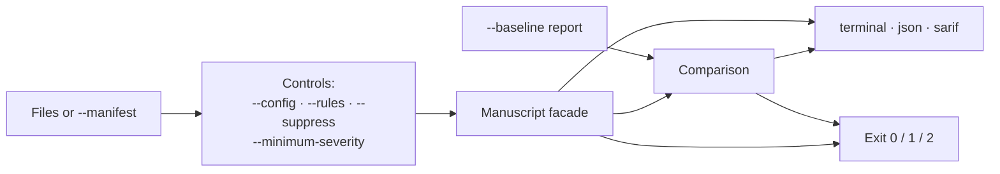

# CLI

The CLI is an optional filesystem adapter over the [manuscript facade](MANUSCRIPT.md).
It reads the files you name, writes one report to stdout, and sets an exit code.

```sh
cargo install --path . --features cli          # or: cargo build --release --features cli --bin narrative-lens
narrative-lens --help
narrative-lens --list-rules --format json
narrative-lens --format terminal --characters Zoë,Mara chapter-01.md chapter-02.txt
narrative-lens --format json --config author.json --fail-on warning chapter-01.md > report.json
narrative-lens --format sarif --rules NL-GRAMMAR-REPETITION chapter-01.md > report.sarif
uv run --locked scripts/validate_sarif.py report.sarif
```



## Inputs

- Each UTF-8 text or Markdown file is one scene, in argument order. Markdown is analyzed verbatim so ranges stay exact.
- Automatic scene IDs encode the canonical path relative to the working directory. Keep the working directory and paths stable across revisions, or use a manifest.
- Duplicate canonical inputs are rejected; files must be regular files within the facade size limits.
- `--document-id` sets identity (default `manuscript`); `--characters NAME,NAME` sets continuity subjects. Use `--` before paths that begin with a dash.

`--manifest manuscript.json` supplies stable IDs and scene metadata. Paths resolve relative to the manifest; it cannot be combined with positional files.

```json
{
  "documentId": "novel",
  "knownCharacters": ["Zoë"],
  "configuration": { "chronology": true, "rules": ["NL-CONTINUITY-LOCKED"] },
  "scenes": [
    { "id": "garden", "path": "chapter-01.md", "chronology": { "key": "02", "lane": "main" } },
    { "id": "cellar", "path": "chapter-02.md", "chronology": { "key": "01", "lane": "main" } }
  ]
}
```

Scenes may also carry `purpose`, `intentions`, and `chronologyLane`.

## Controls

| Flag | Effect |
| --- | --- |
| `--config FILE` | Overlays a [Configuration](MANUSCRIPT.md#author-controls): nested objects merge, arrays replace, omitted fields keep manifest values or defaults |
| `--rules ID,ID` | Selects rules; an adapter-only rule with no facade detector is an invocation error (check `facadeAvailable` in the catalog) |
| `--minimum-severity LEVEL` | Drops findings below `info`, `suggestion`, `warning`, or `error` |
| `--suppress ID` | Repeatable; scoped suppressions with reasons go in configuration |
| `--fail-on LEVEL` | Failure threshold (default `error`); `none` disables it |
| `--max-findings N` | Allows N findings at or above the threshold (default 0), counting findings omitted by the report budget |
| `--require-complete` | Exit 2 when a selected capability is incomplete; intentionally disabled passes are excluded |
| `--verbose` | Shows confidence provenance and every coverage status |
| `--model-root DIR --model-profile FILE` | Local NLI artifacts (`nli-onnx/model.onnx`, `nli-onnx/tokenizer.json`) and a trusted v1 manifest of at most 16 KiB; both flags together, `onnx` feature required |

Unknown options and invalid values are errors. Terminal output shows source paths, UTF-16 line/column positions, suggestions, and conflicting quotations with control characters escaped.

## Baselines

`--baseline FILE` reads a validated facade `Report` (schema 1 or 2) or CLI JSON envelope with the same document ID. JSON output is `{ report, comparison, sources }`; `sources` maps scene IDs to source URIs. `--new-only` requires a baseline and applies thresholds to introduced findings only.

```sh
narrative-lens --format json --fail-on none chapter-01.md > baseline.json
narrative-lens --baseline baseline.json --new-only --fail-on warning chapter-01.md
```

`comparison.complete` is false when either report omits findings, candidate limits hide the compared population, selected work failed or lacks coverage, or an unmatched finding cannot be assessed; `--new-only` then exits 2. Schema-1 baselines still match but should be regenerated as schema 2 for a complete gate. The CLI never writes files: callers own configuration, baselines, and results.

## Exit codes

| Exit | Meaning |
| --- | --- |
| `0` | Completed below the configured finding threshold |
| `1` | Finding threshold exceeded |
| `2` | Invocation, I/O, configuration, or baseline error; required capability failed; requested complete analysis or comparison unavailable |

Optional model failures remain visible as coverage unless strict handling is requested. Errors go to stderr; JSON and SARIF are still written when requested completeness fails after analysis. A closed stdout pipe is handled normally.

## SARIF

Output follows [OASIS SARIF 2.1.0](https://docs.oasis-open.org/sarif/sarif/v2.1.0/sarif-v2.1.0.html):

- `columnKind: utf16CodeUnits`, one-based lines and columns, zero-based UTF-16 offsets, CR/LF/CRLF support
- Original snippets, related locations, the full rule catalog, partial fingerprints, external suppressions, and baseline states (`absent` for resolved findings; incomplete prior assessments appear as review results)
- Old locations keep their original UTF-16 offsets; a bare `Report` keeps old coordinates in `properties.originalEvidence`, so preserve the CLI envelope to retain historical source URIs
- Text offsets exclude an initial UTF-8 BOM; envelopes record `sourceBomUtf16` so baseline locations use the historical convention

Integration tests validate Unicode, cross-file conflicts, resolved, suppressed, and incomplete outputs against the vendored official schema, whose hash is pinned in `tests/fixtures/provenance.json`. `scripts/validate_sarif.py` uses the locked Python dependency in `scripts/validate_sarif.py.lock`.
