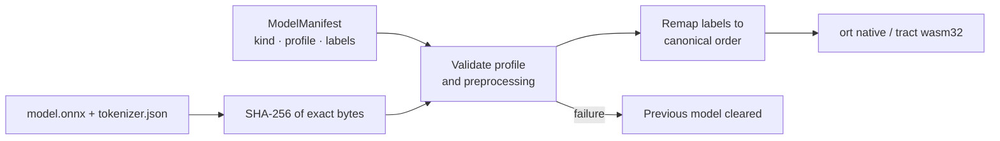

# Integration

| Build | Minimum |
| --- | --- |
| Rust core, `cli`, `bindings` | Rust 1.89 |
| Native ONNX | Rust 1.92 |
| wasm32 ONNX (`tract`) | Rust 1.91 |
| Node package | Node.js 18, 20, 22, 24, or 26 |

The default library uses no network, model download, or persistence. Filesystem
handling belongs to the CLI, the model adapters, and the consuming application.

## Rust

```toml
[dependencies]
narrative-lens = "0.2"
```

Standalone analyzers keep their own signatures:

```rust
use narrative_lens::craft::readability;
let scene = "The rain fell steadily against the window pane.";
let result = readability::compute_readability(scene);
assert!(result.word_count > 0);
```

For coordinated analysis use `manuscript::analyze_manuscript(&Manuscript)`, which
returns a consistent `Report`. Reuse a caller-owned `AnalysisContext` across edits and
compare reports with `try_compare_reports`. [MANUSCRIPT.md](MANUSCRIPT.md) covers
evidence, configuration, intentions, suppressions, availability, chronology,
incremental invalidation, and revision matching. The legacy `Options` and
`AnalysisResult` types are empty compatibility placeholders.

CI runs the executable examples `cargo run --example analyze_passage` and
`cargo run --example manuscript`.

## Node

```js
import { computeReadability, analyzeManuscriptAsync } from 'narrative-lens';
const metrics = computeReadability('The rain fell steadily.');
const report = await analyzeManuscriptAsync({
  documentId: 'novel', scenes: [{ id: 'first', text: 'She was was tired.' }],
});
```

| Surface | Where |
| --- | --- |
| Function and class declarations | `index.d.ts`, generated by napi from `src/napi_bindings/` |
| Manuscript input wrappers and result contracts | `manuscript.d.ts`, `manuscript.generated.d.ts`, `docs/manuscript.schema.json` |
| Standalone result contracts | `standalone.generated.d.ts`, `docs/standalone.schema.json` |
| Facade exports | `analyzeManuscript`, `analyzeManuscriptAsync`, `ManuscriptContext` (`analyze`, `analyzeAsync`, `stats`, `clear`), `compareManuscriptReports`, `parseManuscriptReport`, `defaultManuscriptConfiguration`, `listManuscriptRules` |
| Not exported | `substrate::{text, utils, nlp, wordfreq, nli, sbert}` internals, `continuity::ner` internals, and some model-only or in-place functions |

The generated contracts come from the `bindings` Cargo feature:
`cargo run --features bindings --example export_contracts` and
`... --example export_standalone_contracts`. CI checks generation drift and validates
actual Node results against the schemas. Serde enum tags apply: world facts use
`characterAt`, payoff states include `unknown` and `confirmedFulfilled`.

Async facade calls run on libuv workers; JSON input conversion and final JS
materialization still occupy the event loop.

| Command | Does |
| --- | --- |
| `npm ci && npm run build:debug` | Builds the native addon and regenerates `index.js` and `index.d.ts`; `index.mjs` is the maintained ESM wrapper, so keep its named exports in sync when adding bindings |
| `npm test` | Node tests; fails rather than skips when the addon is missing |
| `npm run test:types` | Strict TypeScript against the generated declarations |
| `npm run test:examples` | Executes the representative Node examples |
| `npm run test:contracts` | Validates facade and standalone outputs against the generated schemas |
| `npm run test:package` | Installs the staged root and platform tarballs without registry access and checks CJS, ESM, manuscript evidence, and installed declarations |

Native `.node` binaries are ignored by Git. Release jobs execute the packed artifacts
on every declared target and Node line before publication; binary digests and text
payload hashes bind what is published to what was tested.

## World state

`trackWorldState` reduces explicit English events in source order. Snapshot `facts`
hold live state; `newFacts` and `invalidatedFacts` record transitions, including facts
introduced and invalidated within one scene. Unobserved knowledge paths stay unknown,
and neutral legacy numbers do not establish a measurement. Named lock/unlock events use
that actor's previously observed location; an unrecognized subject neither borrows
another actor's location nor clears an unrelated lock.

For current state without cumulative snapshots, Rust
`world_state::track_world_state_current(scenes, characters, &options)` and Node
`trackWorldStateCurrent(scenes, characters, options?)` share the same reducer:

| Option | Default | Effect |
| --- | --- | --- |
| `includeEventHistory` | `false` | Keeps historical locations and transmissions |
| `includeDeltas` | `false` | Returns net scene-boundary changes (apply removals, then additions); intra-scene cycles cancel |

The result keeps final facts, current knowledge, and violations; `afterScene` is the
final zero-based scene index, or null when nothing was reduced. Full cumulative
history grows with the sum of all snapshot sizes.

Input limits: at most 10,000 scenes, 256 cast entries, 128 bytes per character name,
16 MiB per scene, and 64 MiB total text; names cannot contain control characters.
`track_world_state_checked` and `track_world_state_current` return `Result`, and both
Node bindings throw on rejected input. Legacy `track_world_state` keeps its return type
and reports `availability: unavailable` with diagnostics on failure; missing
availability in older serialized results also defaults to unavailable.

Related exports: `analyzeAuthorKnowledge` replays source-validated author epistemics
([semantics and limits](MANUSCRIPT.md#author-confirmed-narrative-annotations));
`trainAndFindNearest` and `trainAndSimilarity` propagate corpus limit errors instead
of returning an empty semantic result.

## Coreference and entities

`resolveCoreferences(sceneText, knownCharacters, genderMap?)` resolves pronouns to
cast names. Gender hints are `male`, `female`, `neutral`, or `unknown`; `they`/`them`
binds only to a character hinted `neutral`. Cast entries that prefix one another
(`Hester`, `Hester Prynne`) form one alias group, `resolvedTo` names the entry the
antecedent literally matched, and narrative pronoun chains continue across quoted
dialogue. `buildCharacterGenderMap(scenes, characters)` infers `male`/`female`/`unknown`
from gendered honorifics, listed given names, and nearby pronouns; it never emits
`neutral`. `resolveEntities` makes the fuller name a character's canonical when it has
at least half the support of the bare given name (`Hester Prynne` over `Hester`);
entity IDs are stable, but `EntityCorrection` bins keyed by a bare canonical from
0.1.0 may land differently.

## Local models

Enable `onnx` for the optional SBERT, NER, NLI, and emotion runtimes:

```toml
narrative-lens = { version = "0.2", features = ["onnx"] }
```

```rust
narrative_lens::substrate::sbert::set_model_directory("/path/to/models");
// Native adapter looks for sbert-onnx/{model.onnx,tokenizer.json}.
```



- Models are caller-provided and explicitly selected; there is no current-directory discovery. Native model and tokenizer files are bounded at 1 GiB and 64 MiB.
- Legacy setters keep empty-output fallback and report `unverified_legacy` identity. Their exports must already use the canonical label orders: NLI contradiction/neutral/entailment, emotion anger/disgust/fear/joy/neutral/sadness/surprise, NER `O,B-MISC,I-MISC,B-PER,I-PER,B-ORG,I-ORG,B-LOC,I-LOC`.
- Verified loading: pass a trusted `onnx::model::ModelManifest` to `set_model_directory_verified(kind, root, &manifest)` or `set_model_bytes_verified(kind, model, tokenizer, &manifest)`. Both runtimes hash the bytes loaded, validate version, kind, and profile, and remap the declared class order. Failed verification clears the previous model.
- v1 profiles (`hugging_face_masked_mean_v1`, `hugging_face_bio9_v1`, `hugging_face_ekman7_v1`, `hugging_face_nli3_v1`) require self-contained ONNX, int64 HuggingFace inputs, no tokenizer-side truncation or padding, an existing padding token ID, and at most 4096 tokens.
- A manifest records `schemaVersion: 1`, `kind`, `profile`, lowercase `modelSha256`/`tokenizerSha256`, `maxTokens`, `paddingTokenId`, and source-order `labels` (empty for embeddings).
- `InferenceBackend::model_identity` exposes identity; manuscript reports keep `modelIdentities` from successful NLI analysis. Verification establishes neither accuracy nor the truth of the supplied label meanings.

The [MiniLM parity check](EVALUATION.md#pinned-pretrained-model-parity) records
native and WASI execution with an explicitly adapted tokenizer, and the strict
rejection of the original tokenizer's padding and truncation settings.

For Node model support build with
`npx --no-install napi build --platform --release --features node-api,onnx -- --locked`.
`await loadVerifiedModel('nli', modelRoot, manifest)` loads on a worker; the default
addon rejects model loading because it excludes `onnx`. After loading,
`analyzeManuscriptAsync` records the verified identity, and replacement during
inference discards the NLI results. Keep `modelRevision` current when replacing an
injected backend.

The release profile keeps symbols (`strip = "none"`) to avoid the
[Rust/LLVM strip-debug layout defect](https://github.com/rust-lang/rust/issues/157750)
that the ONNX Node addon reproduced on macOS 27. Default and model-enabled artifacts
must pass actual loading tests; compilation alone does not verify delivery.

## CLI

Enable `cli` for the text/Markdown filesystem adapter with terminal, JSON, and SARIF
output, configuration overlays, rule and severity filters, suppressions, revision
baselines, and failure thresholds. See [CLI.md](CLI.md).
