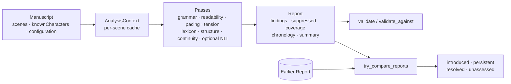

# Manuscript analysis

The optional `manuscript` module coordinates grammar, readability, pacing, syntax
tension, genre profiles, structure templates, author lexicons, and a conservative
continuity pass into one typed `Report`. It needs no feature flag, model, filesystem,
network, project model, or persistence. Standalone analyzer functions keep their
signatures; `Options {}` and `AnalysisResult {}` remain empty legacy placeholders.



Run the complete examples with `cargo run --example manuscript` and, after
`npm run build:debug`, `node examples/manuscript.mjs`.

```rust
use narrative_lens::manuscript::{
    analyze_manuscript, Configuration, Manuscript, Scene,
};
let manuscript = Manuscript {
    document_id: "novel".into(),
    scenes: vec![Scene::new("opening", "She was was tired.")],
    known_characters: vec![],
    configuration: Configuration::default(),
};
let report = analyze_manuscript(&manuscript)?;
# Ok::<(), narrative_lens::Error>(())
```

`Scene` also accepts `purpose`, `intentions`, an optional `Chronology { key, lane }`,
and a `chronologyLane` hint when the key is unknown; `Scene::from_timeline` adapts
existing `TimelineEntry` metadata. Scene IDs belong to the caller and must stay stable
across revisions. Presentation order is the vector order; counts, sentence boundaries,
readability, pacing, and tension inputs are computed by the library.

## Findings and evidence

`Report` schema `"2"` holds ordered findings, suppressed findings with reasons,
per-scene metrics, capability coverage, diagnostics, chronology, presentation IDs, the
resolved configuration, and summary counts that separate detections, suppressions,
returned findings, and findings omitted by the output budget. `Report::validate`
checks identities, ranges, finite confidence, chronology, configuration, fingerprints,
and count integrity; `validate_against(&manuscript)` also checks every quotation and
coordinate against the exact original text.

Each `Finding` carries a document ID, stable rule ID, typed severity, suggestion,
confidence provenance, explicit scope, evidence, and a revision fingerprint.

| Range field | Unit | Note |
| --- | --- | --- |
| `byteStart..byteEnd` | UTF-8 bytes | Zero-based, half-open, relative to the original scene text |
| `utf16Start..utf16End` | UTF-16 code units | Suitable for JavaScript `text.slice(start, end)` |

Text is never normalized before locating evidence; combining marks and astral
characters keep their boundaries, and `TextRange::new`/`TextRange::from_utf16` reject
invalid boundaries such as a split surrogate pair. Quotes equal both slices exactly.

- Passage findings identify primary and conflicting evidence with roles. Physical continuity findings quote both passages; a locked-location finding separates the earlier location from its constraint.
- Scene and manuscript aggregate findings (a missing beat, an aggregate grade) have explicit scope and may carry no pinpoint quote. Readability and pacing may add an illustrative sentence with the `context` role without turning the aggregate into a pinpoint claim.
- Evidence keeps up to 64 original characters on either side within sentence boundaries for revision matching.
- `finding::adapt_grammar` and `finding::adapt_explanation` adapt legacy results; call `assign_fingerprints(document_id, &mut findings)` after assembling a batch so duplicate occurrences get distinct ordinals.

| Rule | Interpretation |
| --- | --- |
| `NL-GRAMMAR-REPETITION` | Consecutive identical words separated by whitespace |
| `NL-GRAMMAR-WHITESPACE` | Extra interior ASCII spaces |
| `NL-GRAMMAR-SPELLING` | Lowercase word absent from the local frequency dictionary; may be invented or dialect |
| `NL-GRAMMAR-CAPITALIZATION` | Reserved adapter ID; explicit facade selection is rejected because no detector exists |
| `NL-READABILITY-COMPLEX` | Scene FKGL exceeds the genre or custom maximum, with an adequate sample |
| `NL-PACING-LONG` | Average sentence length exceeds the genre or custom maximum |
| `NL-PROSE-LEXICON` | Literal whole-word author-configured terms; ASCII-insensitive, Unicode boundaries |
| `NL-STRUCTURE-MISSING-BEAT` | Template scorer cannot match a beat from scene purposes, position, and tension |
| `NL-CONTINUITY-LOCKED` | A named character changes location while an observed constraint is active |
| `NL-CONTINUITY-ATTRIBUTE` | Explicit eye-color assertions disagree |
| `NL-CONTINUITY-OBJECT` | Explicit key/sword/letter/ring/book location assertions disagree without an observed transfer |
| `NL-CONTINUITY-NLI` | Optional local three-class model reviews sentence pairs inside a configured scene window |

This is a defined facade surface, not an orchestration of every standalone analyzer;
emotion, theme, voice, causal, and epistemic analyzers keep their standalone APIs.
Physical facts come from explicit English patterns, known subjects and aliases, and
release/transfer events. Unrecognized states stay unknown, and missing transitions or
template matches are review suggestions, not proof of an author error.

## Author controls

`Configuration` serializes with camelCase keys, defaults for omitted fields, and
rejection of unknown fields. Nothing is read from or saved to disk. `Genre` uses the
Rust enum labels (`"Fantasy"`, `"SciFi"`, ...); threshold overrides apply over the
genre profile.

```json
{
  "genre": "Fantasy",
  "thresholds": { "maxGrade": 16, "minSceneWords": 100 },
  "dictionary": ["wyrmlet"],
  "lexicon": ["very", "suddenly"],
  "rules": ["NL-GRAMMAR-SPELLING", "NL-PROSE-LEXICON"],
  "minimumSeverity": "suggestion",
  "suppressions": [
    { "ruleId": "NL-PROSE-LEXICON", "sceneId": "opening", "reason": "Deliberate narrator diction" }
  ]
}
```

- `rules: null` or omission selects every supported rule; `rules: []` selects none.
- `dictionary` additions suppress spelling suggestions case-insensitively; `lexicon` replaces the author term list, not the bundled English dictionary.
- `entityCorrections` uses `{ surface, action: { kind: "assign", canonical } }` or `{ kind: "reject" }` for continuity aliases. It never rewrites text or shifts ranges; later corrections for a surface win.
- Suppressions match every supplied selector (rule, scene, fingerprint), require a reason and at least a rule or fingerprint, and stay visible in `report.suppressed`. A manuscript-scope finding matches a scene suppression when that scene is in its aggregate scope.

| Scene intention | Effect |
| --- | --- |
| `repetition`, `dialect`, `complex_prose`, `long_sentences` | Relaxes the corresponding rule for that scene |
| `nonlinear` | Conventional structure analysis is skipped when every nonempty scene declares it |
| `open_ending` | On the final scene, exempts closing beats only; setup and climax findings remain |
| `supernatural` | Clears physical state across an intentional discontinuity |

Validation bounds (inclusive):

| Setting | Bounds |
| --- | --- |
| `maxGrade` | 0-30, finite |
| `maxSentenceWords` | 1-500, finite |
| `minSceneWords` | 1-100,000; default 100 |
| `minStructureScenes` | 2-10,000; default 3 |
| `nliContradiction` | 0-1, finite; default 0.8 |
| IDs, chronology keys, lanes | 1-256 UTF-8 bytes; no control characters |
| Known characters | At most 256; names 1-128 bytes; unique ignoring case |
| Dictionary, lexicon | At most 4,096 entries each, 1-128 bytes each |
| Corrections, suppressions | At most 4,096 each; suppression reason 1-1,024 bytes |
| Input | At most 10,000 scenes, 16 MiB per scene, 64 MiB total UTF-8 text |
| Cache budget | 0-256 MiB; default 16 MiB |

`limits` sets validated work budgets:

| Limit | Default | Allowed |
| --- | ---: | ---: |
| `maxFindings` | 10,000 | 1-100,000 |
| `sceneCandidates` | 4,096 per pass and scene | 1-65,536 |
| `nliPairs` | 128 | 1-65,536 |
| `nliSentencesPerScene` | 8 | 1-64 |
| `nliWindowScenes` | 1 | 1-128 |
| `modelInputBytes` | 16,384 | 1-65,536 |

Grammar and lexicon each use `sceneCandidates`; the world-event budget is twice that
value so assertions and transitions both fit. Rule selection, dictionary additions,
and intentions apply before candidate collection, suppressions apply before the output
budget, and active and suppressed records each have a `maxFindings` cap while summary
counts keep totals. Exceeding a limit produces a diagnostic and partial coverage;
truncated physical state is not carried into later comparisons.

## Confidence and availability

Heuristic scores describe engineering evidence strength, not validated probabilities of
editorial correctness. `confidence.source`, `method`, and `calibrationId` distinguish
heuristic, model, and calibrated values; defaults carry no calibration ID. NLI softmax
scores record model provenance and the caller-supplied `modelRevision` and remain
uncalibrated.

Every capability reports a status, total and analyzed unit counts, and diagnostics:

| Status | Meaning |
| --- | --- |
| `complete` | Selected pass finished over eligible inputs; no claim of semantic completeness |
| `heuristic_fallback` | Deterministic substitute used, or partial candidate, report, or chronology coverage |
| `unavailable` | Capability disabled, unselected, or model unavailable |
| `insufficient_input` | Empty or short text, or no eligible pairs or scenes |
| `execution_failure` | Incompatible model output or load, or inference failure |

`nli` is `disabled` by default, `fallback` for optional model analysis, or `required`
for strict handling. A required pass returns `AnalysisFailed` when unavailable,
failing, insufficient, or candidate-limited; invalid configuration returns `InvalidInput`.

With `onnx`, native model loading uses only an explicitly configured root with the
analyzer subdirectory (`sbert-onnx`, `ner-onnx`, `nli-onnx`, `emotion-onnx`) holding
`model.onnx` and `tokenizer.json`. Setters replace or retry models after first use and
invalidate retained analysis through a model-generation counter.

- Caller-owned runtimes plug in through `analyze_with_backend`, `AnalysisContext::analyze_with_backend`, and the `InferenceBackend` trait (`check_model`, `embed_checked`, `tag_batch_checked`, `classify_checked`, `classify_pairs_checked`).
- `onnx::checked::{nli, embeddings, entities, emotion}` validate availability, cardinality, tensor shape, finite values, probability distributions, and NER byte ranges, and bound batches, token counts, dimensions, and allocations.
- NLI returns canonical contradiction/neutral/entailment order; verified manifests remap source label order, legacy models must already export it, and shape checks cannot establish label meaning.
- Successful NLI reports include `modelIdentities` (a verified manifest or explicit unverified legacy provenance). Replacement mid-pass discards that pass's NLI findings, and required mode returns an error. Older reports without identity metadata still import without acquiring a verification claim.
- Twelve tiny untrained local ONNX graphs exercise success, incompatible output, and real execution failure for all four capabilities; they test runtime contracts, not model accuracy, and no model weights back the synthetic accuracy claims.

## Chronology and reader knowledge

Chronology is opt-in: set `configuration.chronology = true` and give each scene a
`{ key, lane }`. Keys are author-defined strings sorted lexicographically within a
lane (use fixed-width numbers or sortable timestamps); the library never interprets
dates or infers order from prose. Scenes stay in presentation order, and physical
state is evaluated in story order independently per lane.

| Situation | Policy |
| --- | --- |
| Tied keys | Local uncertainty barrier: state clears at the tied group; unambiguous segments before and after are still checked |
| Scene with a known `chronologyLane` but no key | Blocks physical comparisons in that lane |
| Unknown lane | Blocks all physical comparisons, since that scene might explain any transition |

Diagnostics retain the ambiguity; the policies prefer a missed contradiction to a
speculative one. With chronology enabled, `chronology.readerKnowledge` records, in
presentation order, the first explicit learned/discovered/knew/realized fact with its
passage. It is a reader introduction ledger, not proof of character access or evidence
that a flashback is an error.

## Author-confirmed narrative annotations

`continuity::author_knowledge::analyze_author_knowledge(&manuscript, &propositions, &events)`
and Node `analyzeAuthorKnowledge(manuscript, propositions, events)` replay explicit
author annotations. Propositions have stable IDs, descriptions, a `"true"`, `"false"`,
or `"unknown"` baseline, and exact source evidence. Each event has a unique ID, a
unique unsigned 32-bit `sequence`, a `propositionId`, an action, and a source; input
order never changes replay order.

| Action | Semantics |
| --- | --- |
| `believe` | Records a belief; matching declared truth yields `correct_belief`, not knowledge |
| `know` | Requires an explicit author knowledge assertion matching current truth |
| `uncertain`, `forget` | Preserve explicit uncertainty and unknown state |
| `communicate` | Sender, recipient, stated Boolean value, and `uptake` (`unchanged`, `belief`, `knowledge`); permits deception without copying the speaker's belief |

Actors are `{kind:"reader"}` or `{kind:"character",characterId:"Alice"}`; characters
must match `knownCharacters` exactly, and a character named `reader` stays distinct
from the reader. Truth changes reclassify existing assertions without informing any
actor. Missing actor/fact pairs stay unassessed. Replay is one author-defined
sequence, not an inferred timeline; use separate proposition IDs for distinct temporal
claims. Source validation proves quote and range identity, not that the passage entails
the annotation. Limits: 10,000 propositions, 10,000 events, 4 MiB of annotation strings.
Results do not populate facade findings automatically.

`structure::author_events::analyze_promise_events(&manuscript, &events)` and Node
`analyzePromiseEvents(manuscript, events)` keep a separate author-confirmed ledger. A
`setup` has a stable `id`, description, and source evidence; a `resolution` names its
`setupId` and an outcome of `fulfilled`, `partial`, `subverted`, or `abandoned`.
Evidence is `{ sceneId, utf16Start, utf16End, quote }`, returned with byte ranges and
local context. An unlinked setup has unknown resolution even if later prose seems to
answer it. Event IDs share one namespace, a setup permits one current resolution, and a
replacement snapshot revises decisions. Stale quotes, surrogate splits, unknown
references, and duplicate decisions are errors. Limits: 10,000 events, 4 MiB of
annotation fields, 64 KiB per quote, 4,096 bytes per setup description.

## Reanalysis and revisions

`AnalysisContext` belongs to the caller; reuse it across manuscripts and call `clear`
to release the scene cache. It caches grammar, segmentation, readability, pacing,
tension, and evidenced world events by exact scene ID and text, sharing intermediates
through `Arc`.

| Change | Recomputed |
| --- | --- |
| Scene text edit | That scene; cross-scene passes rerun from cached intermediates |
| Insertion, deletion, reordering, purposes, intentions, chronology | Membership and the dependent passes |
| Thresholds, output filters, model revision | Nothing scene-level; raw metrics are reused |
| Dictionary or grammar selection | Grammar |
| Cast, corrections, world selection | Evidenced world events |

Model inference is never cached, so replacing an injected backend cannot return stale
model findings, and incremental output equals fresh output. The cache budget bounds
retained payload estimates (string and vector capacities, map-node allowances,
dependency metadata) with deterministic scene-ID eviction; zero disables retention.
Temporary work, inputs, reports, allocator bookkeeping, and runtime models fall outside
the budget. `stats()` reports reuse, recomputation, retained bytes, entry count, and
per-component recomputation counts. This is a scene cache, not revision storage.

`try_compare_reports(before, after)` validates both reports and their document
identity, then returns introduced, persistent (before/after pairs), resolved, and
`unassessed` findings; `compare_reports` is the unchecked counterpart.

- Matching uses full anchors: document ID, rule ID, stable scene ID (or sorted aggregate scene IDs and message), and ordered primary/conflict evidence scene IDs and quotes. Illustrative `context` evidence, offsets, order, severity, and confidence are excluded.
- Quotes collapse whitespace and lowercase Unicode without normalization. Exact local contexts match first; remaining identical evidence matches as an ordered multiset. `matchKind` distinguishes `context`, `evidence`, and `ambiguous_occurrence`.
- Duplicate occurrences get distinct ordinals and `nl-v2` FNV-1a fingerprints; adding or removing an indistinguishable copy changes multiplicity without claiming which copy was edited. Moving content to a new scene ID or changing evidence wording reads as introduced plus resolved.
- Suppressing an active finding resolves it in the active-finding comparison. A rule disabled, unavailable, insufficiently sampled, or truncated in the counterpart cannot establish a repair or regression; those findings are `unassessed` with a reason.
- `comparison.complete` is false when either report has omitted findings, candidate limits, unavailable selected work, or an older schema that cannot prove exhaustive coverage. Rust callers recompute it with `is_complete(before, after)`; the CLI's `--new-only` exits 2 when completeness is unproved. Regenerate schema-1 baselines before using them as a CI gate.

## Node

`index.d.ts` is generated by napi and references the typed `manuscript.d.ts` input
wrappers and `manuscript.generated.d.ts` result contracts. The contracts and
`docs/manuscript.schema.json` are generated from the Rust types:

```sh
cargo run --features bindings --example export_contracts
cargo run --features bindings --example export_contracts -- --check
npm run test:contracts
```

```js
import { analyzeManuscriptAsync, ManuscriptContext } from 'narrative-lens';
const manuscript = {
  documentId: 'novel',
  scenes: [{ id: 'opening', text: 'She was was tired.' }],
};
const report = await analyzeManuscriptAsync(manuscript);
const context = new ManuscriptContext(16 * 1024 * 1024);
const next = await context.analyzeAsync(manuscript);
```

| Export | Purpose |
| --- | --- |
| `analyzeManuscript`, `analyzeManuscriptAsync` | One-shot analysis, sync or on a libuv worker |
| `ManuscriptContext` (`analyze`, `analyzeAsync`, `stats`, `clear`) | Incremental analysis with a caller-owned cache |
| `compareManuscriptReports` | Typed revision comparison |
| `parseManuscriptReport` | Validates persisted JSON before use |
| `defaultManuscriptConfiguration`, `listManuscriptRules` | Resolved defaults and the rule catalog |

Async work runs on the worker pool via [napi ScopedTask](https://napi.rs/docs/concepts/async-task);
input conversion and final JS materialization still run on the event loop. Concurrent
operations on one context may reject with `analysis context is busy`; retry after the
current promise resolves or use separate contexts. The context mutex guards ownership
only and is released during computation. Native tests require the addon and verify
timer progress during novel-sized work.

See [CLI](CLI.md) and [evaluation and benchmarks](EVALUATION.md).
